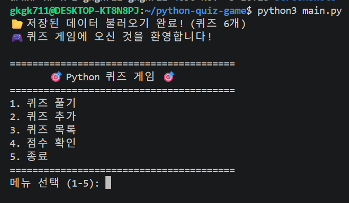
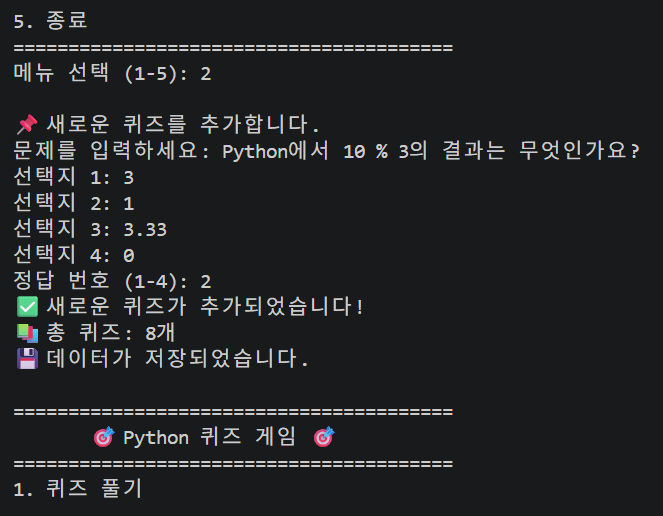
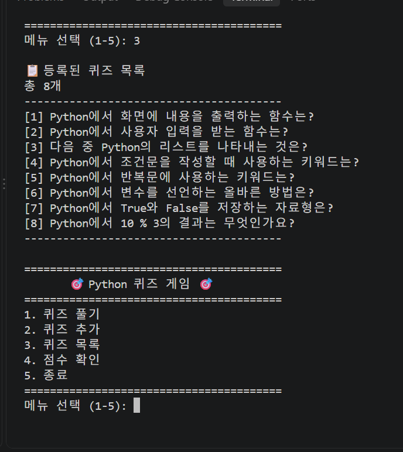
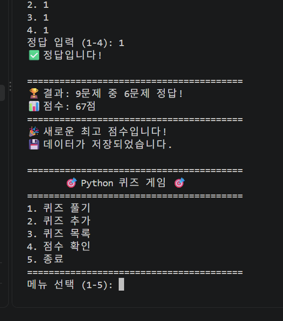
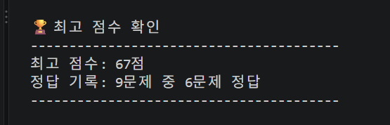
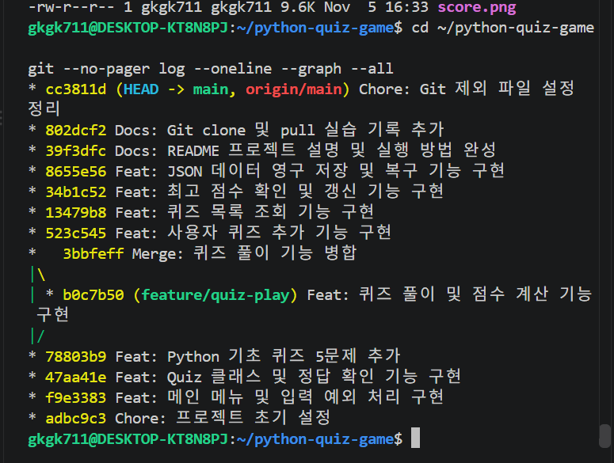
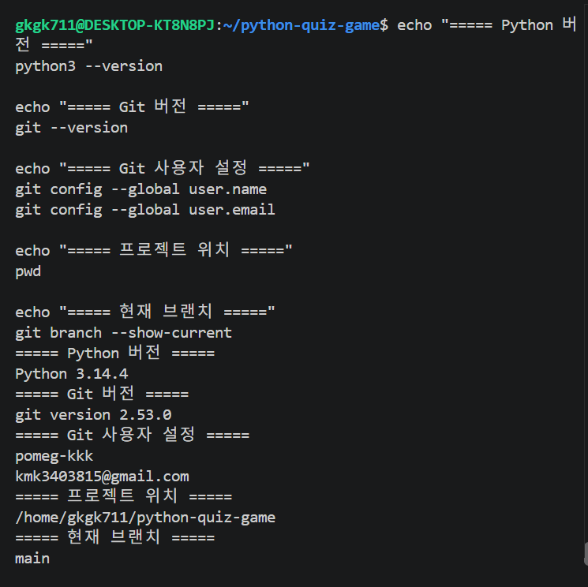

# 🎯 Python 콘솔 퀴즈 게임

## 1. 프로젝트 개요

Python 기본 문법과 객체 지향 프로그래밍을 학습하기 위해 제작한 콘솔 기반 퀴즈 게임입니다.

사용자는 퀴즈를 풀고 새로운 문제를 등록할 수 있습니다.
퀴즈 데이터와 최고 점수는 JSON 파일에 저장되어 프로그램을 종료한 후에도 유지됩니다.

## 2. 퀴즈 주제 및 선정 이유

**퀴즈 주제:** Python 기초 문법

Python의 변수, 자료형, 조건문, 반복문, 함수 등 핵심 개념을 복습하고 실제 프로그램으로 구현해 보기 위해 선정했습니다.

## 3. 개발 환경

- Python 3.10 이상
- Ubuntu (WSL)
- Visual Studio Code
- Git / GitHub
- Python 표준 라이브러리

외부 라이브러리는 사용하지 않았습니다.

## 4. 설치 및 실행 방법

### GitHub 저장소 복제

```bash
git clone https://github.com/pomeg-kkk/cdsy_ms2-python-quiz-game.git
```

### 프로젝트 폴더 이동

```bash
cd cdsy_ms2-python-quiz-game
```

### 프로그램 실행

```bash
python3 main.py
```

Windows에서 Python 명령어를 사용하는 경우 다음과 같이 실행할 수도 있습니다.

```bash
python main.py
```

## 5. 주요 기능

| 메뉴 | 기능 | 설명 |
|---|---|---|
| 1 | 퀴즈 풀기 | 등록된 퀴즈를 풀고 정답 및 점수를 확인합니다. |
| 2 | 퀴즈 추가 | 문제, 선택지 4개, 정답 번호를 입력합니다. |
| 3 | 퀴즈 목록 | 저장된 퀴즈 목록을 출력합니다. |
| 4 | 점수 확인 | 최고 점수와 정답 기록을 확인합니다. |
| 5 | 종료 | 데이터를 저장하고 종료합니다. |

### 예외 처리

- 숫자가 아닌 입력 처리
- 빈 입력 처리
- 허용 범위를 벗어난 숫자 처리
- Ctrl+C 및 EOFError 안전 종료
- JSON 파일이 없을 때 기본 퀴즈 생성
- JSON 파일이 손상되었을 때 기본 데이터 복구
- 파일 읽기 및 쓰기 오류 처리

## 6. 프로젝트 파일 구조

```text
python-quiz-game/
├── main.py
├── quiz.py
├── quiz_game.py
├── quiz_data.py
├── state.json
├── README.md
├── .gitignore
└── docs/
    └── screenshots/
        ├── menu.png
        ├── add_quiz.png
        ├── list.png
        ├── play.png
        ├── score.png
        ├── git_log.png
        └── environment.png
```

### 파일별 역할

- `main.py`: 메뉴 출력 및 프로그램 실행
- `quiz.py`: Quiz 클래스, 문제 및 정답 관리
- `quiz_game.py`: QuizGame 클래스, 게임 진행 및 데이터 저장
- `quiz_data.py`: Python 기초 퀴즈 5문제
- `state.json`: 퀴즈 목록과 최고 점수 저장
- `README.md`: 프로젝트 설명
- `.gitignore`: Git 추적 제외 파일 설정

## 7. JSON 데이터 저장

데이터는 프로젝트 루트의 `state.json` 파일에 UTF-8 형식으로 저장됩니다.

### 데이터 구조 예시

```json
{
  "quizzes": [
    {
      "question": "Python에서 화면에 내용을 출력하는 함수는?",
      "choices": [
        "input()",
        "print()",
        "len()",
        "type()"
      ],
      "answer": 2
    }
  ],
  "best_score": 80,
  "best_correct": 4,
  "best_total": 5
}
```

### 데이터 필드

| 필드 | 설명 |
|---|---|
| quizzes | 퀴즈 목록 |
| question | 문제 내용 |
| choices | 선택지 4개 |
| answer | 정답 번호 (1~4) |
| best_score | 최고 점수 (0~100점, 기록 없으면 null) |
| best_correct | 최고 점수 기록의 정답 개수 |
| best_total | 최고 점수 기록의 전체 문제 수 |

프로그램을 처음 실행할 때 데이터 파일이 없으면 기본 퀴즈 5개를 생성합니다.

파일이 손상되면 오류를 안내하고 기존 파일을 백업한 뒤 기본 퀴즈 데이터로 복구합니다.

## 8. Python 학습 내용

- 변수와 자료형 (int, str, bool, list, dict)
- 조건문 (if, elif, else)
- 반복문 (for, while)
- 함수 및 반환값
- 클래스와 객체
- 생성자 (`__init__`)와 `self`
- JSON 파일 입출력
- try/except 예외 처리

## 9. Git 개발 과정

Git을 활용하여 기능별 변경 이력을 관리했습니다.

- `git init`: 로컬 저장소 초기화
- `git add`: 변경 파일 등록
- `git commit`: 기능별 변경 기록
- `git push`: GitHub에 업로드
- `git checkout`: 브랜치 생성 및 이동
- `git merge`: 개발 브랜치를 main에 병합
- `git clone`: GitHub 저장소 복제
- `git pull`: 원격 변경사항 가져오기

### 브랜치 실습

`feature/quiz-play` 브랜치에서 퀴즈 풀이 기능을 구현한 뒤 `main` 브랜치에 병합했습니다.

### Clone 및 Pull 실습

1. GitHub 저장소를 별도 폴더에 복제했습니다.
2. 복제본에서 README를 수정했습니다.
3. 변경사항을 커밋하고 GitHub에 Push했습니다.
4. 원본 프로젝트에서 Pull로 변경사항을 가져왔습니다.

## 10. 프로젝트 실행 화면

### 메인 메뉴



### 퀴즈 추가



### 퀴즈 목록



### 퀴즈 풀이 결과



### 최고 점수 확인



### Git 커밋 및 브랜치 병합



### 개발 환경



## 11. 향후 개선 사항

- 랜덤 문제 출제
- 퀴즈 문제 수 선택
- 힌트 기능
- 퀴즈 삭제 기능
- 점수 기록 히스토리

## 12. 프로젝트 저장소

https://github.com/pomeg-kkk/cdsy_ms2-python-quiz-game
